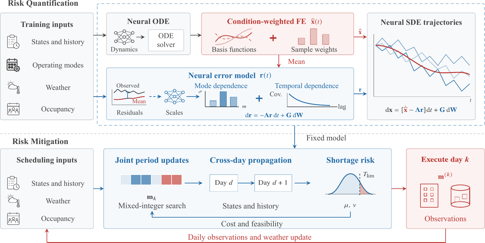
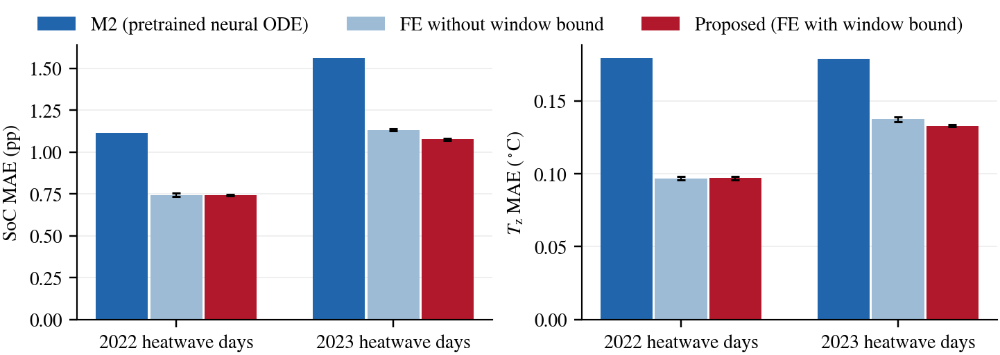
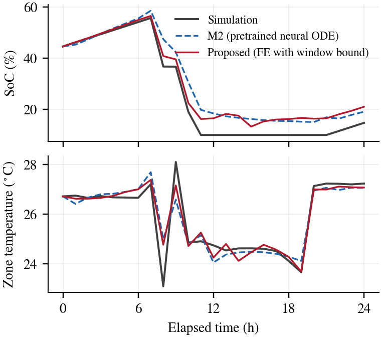
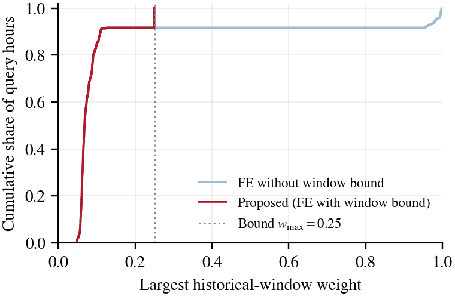

# Heatwave ISS: Condition-Weighted Function Encoding

This repository accompanies the paper **"Risk-Aware Ice Storage Scheduling Against Cooling Shortages During Heatwaves"** (under review). It provides a compact implementation of the mean-trajectory adaptation component, *condition-weighted function encoding (FE)*, together with the data and weights needed to reproduce the heatwave modeling results in Table II of the paper. The neural SDE uncertainty model and the cross-day scheduling strategy are described in the paper and are not part of this repository.



*Framework of the paper (Fig. 2). This repository implements the condition-weighted FE block.*

## Method

A neural ODE pretrained on normal operation provides a baseline trajectory $\mathbf x_{\mathrm{NN}}(t)$. FE corrects zone temperature and state of charge (SoC) with shared learned basis functions $\boldsymbol\psi(t)$ and target-specific coefficients $\mathbf B(t)$:

$$
\widehat{\mathbf x}(t)=\mathbf x_{\mathrm{NN}}(t)+\mathbf B(t)^{\mathsf T}\boldsymbol\psi(t).
$$

Historical samples are weighted by the similarity of their operating conditions $\mathbf c_i(t)$ to those of the target day $\mathbf c(t)$:

$$
\bar w_i(t)=\frac{\beta_i\exp\left(-\|\mathbf c(t)-\mathbf c_i(t)\|_2^2/(2\ell_t^2)\right)}{\sum_{s=1}^{N}\beta_s\exp\left(-\|\mathbf c(t)-\mathbf c_s(t)\|_2^2/(2\ell_t^2)\right)}.
$$

Daily samples are grouped into operating windows $\mathcal D_g$, and the total weight of each window is bounded so that no single window dominates:

$$
\mathbf w^\star(t)=\arg\min_{\mathbf w\ge\mathbf 0}\sum_{i=1}^{N}w_i\ln\frac{w_i}{\bar w_i(t)}
\quad\text{s.t.}\quad \sum_{i=1}^{N}w_i=1,\quad \sum_{i\in\mathcal D_g}w_i\le w_{\max}\ \ \forall g.
$$

The coefficients follow from a weighted ridge regression, with $\boldsymbol\Omega=\operatorname{diag}(\mathbf w^\star)$:

$$
\left(\boldsymbol\Phi^{\mathsf T}\boldsymbol\Omega\boldsymbol\Phi+\lambda_B\mathbf I\right)\mathbf B=\boldsymbol\Phi^{\mathsf T}\boldsymbol\Omega\mathbf E,
$$

where $\boldsymbol\Phi$ stacks the basis values and $\mathbf E$ the residuals of the historical samples. The basis functions are trained by differentiating through this solve, with year-grouped folds: coefficients are fitted on the other years and the loss is evaluated on the held-out year. Adapting the mean to a new day requires no retraining.

## Quick start

Python 3.10–3.12, CPU only:

```bash
python -m venv .venv && source .venv/bin/activate   # Windows: .venv\Scripts\activate
pip install -r requirements.txt
python reproduce.py
```

On Linux, `pip install torch==2.3.0 --index-url https://download.pytorch.org/whl/cpu` avoids downloading the CUDA libraries. The default run evaluates the bundled checkpoints in under a minute, checks all bundled files against `manifest.json`, compares the metrics with `reference_metrics.json`, and writes tables and figures to `results/pretrained/`.

To refit the basis functions from the bundled initialization (three fitting runs for each FE variant):

```bash
python reproduce.py --train                              # full refit, results/retrained/
python reproduce.py --train --epochs 2 --seeds 31626     # short smoke test
```

A full refit takes about 20 minutes on a laptop-class CPU. Refitting is not bit-identical across platforms and thread counts; in our tests the refitted metrics agree with the reference values within 0.02 pp (SoC) and 0.001 °C, and the run checks them with a tolerance of 0.05 pp and 0.005 °C.

## Results

Daily MAE on the heatwave days, averaged over three fitting runs (mean ± standard deviation; paper Table II and Section V-B):

| Model | 2022 SoC (pp) | 2022 $T_z$ (°C) | 2023 SoC (pp) | 2023 $T_z$ (°C) |
|---|---:|---:|---:|---:|
| M2 (pretrained neural ODE) | 1.1157 | 0.1795 | 1.5620 | 0.1791 |
| FE without window bound | 0.7434 ± 0.0098 | 0.0969 ± 0.0012 | 1.1332 ± 0.0080 | 0.1375 ± 0.0016 |
| **Proposed (FE with window bound)** | **0.7425** ± 0.0060 | **0.0971** ± 0.0012 | **1.0765** ± 0.0057 | **0.1330** ± 0.0008 |

On the 2023 heatwave days, the proposed model reduces SoC MAE by 31.1% and zone-temperature MAE by 25.8% relative to M2. Bounding each window's weight lowers the 2023 SoC MAE from 1.1332 to 1.0765 pp.



*Daily MAE on the heatwave days; whiskers show the standard deviation over the three fitting runs.*



*July 15, 2023 (one fitting run), the day shown in Fig. 5 of the paper. Relative to M2, the proposed model lowers the daily SoC MAE from 5.06 to 4.23 pp and the zone-temperature MAE from 0.35 to 0.28 °C.*



*Largest weight that any single historical window receives, over all heatwave query hours. The bound $w_{\max}=0.25$ prevents single windows from dominating the correction.*

## Files

| Path | Content |
|---|---|
| `fe.py` | FE model: features, condition weights, window bound, ridge solve, training loss |
| `reproduce.py` | Evaluation, refitting, reference check, tables, and figures |
| `config.json` | Fixed settings ($\lambda_B=0.003$, $w_{\max}=0.25$, 120 epochs, seeds) |
| `data/train.npz` | 481 training days (2004–2021), including 44 heatwave days |
| `data/dev.npz` | 2022 days (5 heatwave, 27 normal operation) and the 19 heatwave days of 2023 |
| `data/days.csv` | Day IDs, dates, heatwave flags, and operating windows |
| `data/training_year_folds.npy` | Year-grouped folds for basis training |
| `checkpoints/` | Initial basis weights and the fitted weights of both FE variants (three runs each) |
| `manifest.json`, `reference_metrics.json` | SHA-256 digests and reference metrics |

## Data

The data are Modelica simulations of a five-zone office building with a chiller and an ice storage tank under Phoenix weather (2004–2023). Heatwave days are days whose mean outdoor temperature, and that of the preceding day, exceed 38 °C. As in the paper, the 2022 and 2023 days are used for development and single-day evaluation. Each day contains the initial history `past`, the prescribed inputs `u`, `d`, and `cmd`, the pretrained neural ODE trajectory `base`, and the simulated trajectory `truth`. The five states are three water-side temperatures, zone temperature (°C), and SoC (fraction), in this order. Only zone temperature and SoC are corrected.

## Citation

```bibtex
@article{long2026heatwave,
  title  = {Risk-Aware Ice Storage Scheduling Against Cooling Shortages During Heatwaves},
  author = {Long, Zeyang and Yu, Xuanhao and Cui, Xueyuan and Wang, Yi},
  note   = {Under review},
  year   = {2026}
}
```

## License

Released under the [MIT License](LICENSE).
